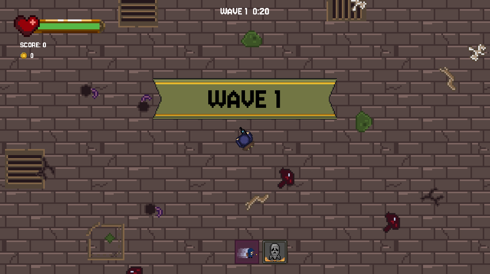
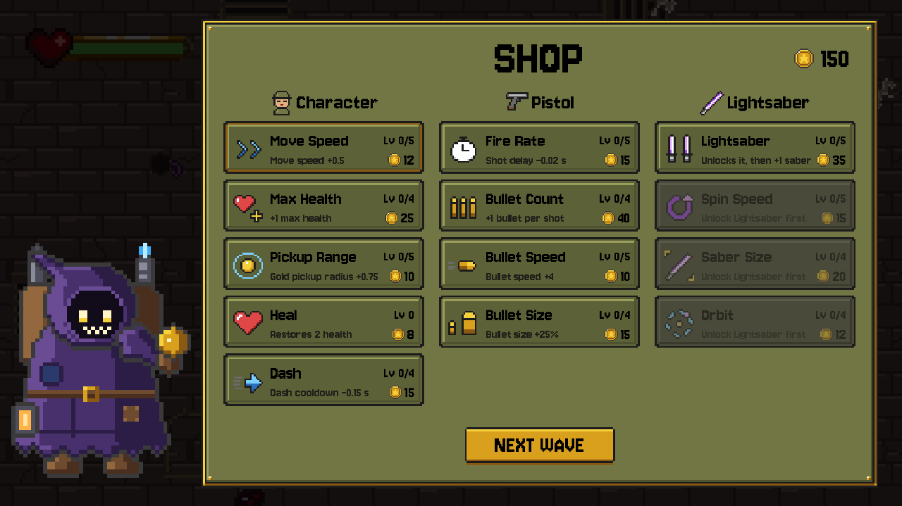

# Freak Survivor

A wave-based 2D pixel art survival game in the style of Vampire Survivors / Brotato, ported from Unity to **Godot 4.7**.

Hold out against hordes of monsters until each wave's timer runs out, collect the gold they drop, then spend it at the travelling merchant's shop to upgrade your character, your pistol and your lightsaber. Enemies get faster and spawn more often as the waves go on.





## Gameplay

1. **Main menu:** pick a difficulty (Easy / Normal / Hard) and a language (TR / EN), then **PLAY**.
2. **Wave:** a "WAVE N" banner slides by and the timer starts. Each wave lasts `min(20 + 5 × (N − 1), 60)` seconds.
3. Every enemy you kill drops **gold** (10 for the golem, 1 for the rest). Gold inside your pickup range flies to you; the **magnet** pulls in all gold on the ground.
4. **When the timer runs out:** the remaining enemies are cleared and any gold you didn't pick up disappears.
5. **Shop:** buy upgrades with your gold, then press **NEXT WAVE**.
6. When you die, the Game Over screen shows the wave you reached. Gold and upgrades only last for the current run and are not saved.

A **golem** (mini boss) appears halfway through every 5th wave.

### Controls

| Key | Action |
|---|---|
| WASD / Arrow keys | Move |
| Mouse | Aim |
| Left click (hold) | Shoot |
| Shift | Dash (briefly invulnerable) |
| Q | Nuke (kills every enemy on screen, 60 s cooldown) |
| Esc | Pause (during a wave) |

### Shop

| Category | Upgrades |
|---|---|
| **Character** | Move Speed, Max Health, Pickup Range, Heal (unlimited), Dash cooldown |
| **Pistol** | Fire Rate, Bullet Count, Bullet Speed, Bullet Size |
| **Lightsaber** | Lightsaber (first purchase unlocks it, then +1 saber), Spin Speed, Saber Size, Orbit |

Prices go up with every level: `round(base_cost × cost_growth ^ level)`.

### Enemies

Rat, Eye, Mummy, Zombie, Goblin and the **Golem** mini boss. Their speed and spawn rate scale with the chosen difficulty and the wave number.

## Running the game

1. Install [Godot 4.7](https://godotengine.org/).
2. Open `project.godot` in Godot and press **F5** (main scene: `scenes/main_menu.tscn`).

**Windows build:** *Project → Export → Windows Desktop* produces `build/FreakSurvivor.exe` (`build/` is not tracked by git).

### Tests

Shop pricing / purchase logic and a translation check:

```bash
godot --headless -s tests/test_upgrades.gd
```

Prints `test_upgrades: OK` on success; a failed assert exits with code 1.

## Project structure

```
scenes/          main_menu, game, gold, bullet, isin_kilici (lightsaber), miknatis (magnet), enemies/
scripts/
  game_manager.gd      score, gold, kills (kill_enemy), pause / game over
  wave_manager.gd      wave loop: INTRO → FIGHT → CLEANUP → SHOP
  enemy_spawner.gd     spawn rate by wave number, golem
  shop_panel.gd        shop UI (cards are built in code)
  upgrades.gd          shop data and purchase logic
  settings.gd          difficulty, volume, language (autoload: Settings)
  transition.gd        fade between scenes (autoload: Transition)
assets/
  sprites/ui/          shop UI assets + Aseprite Lua generators
  sprites/merchant/    merchant
  sprites/pickups/     gold coin
  sprites/map/         ground and decorations
  translations/        strings.csv (TR / EN)
tests/           test_upgrades.gd
```

Code comments are in Turkish.

### Adding a new upgrade

No code changes needed, only data: add an entry to `LIST` in `scripts/upgrades.gd`. `target` is the node path in the game scene and `method` is the function called on it (`target.call(method, amount)`). Add the English name and description to `assets/translations/strings.csv` as well; the test catches missing translations.

### Translations

All text lives in `assets/translations/strings.csv` (`keys,tr,en`). The key is the Turkish text itself. Code uses `tr("...")`; Labels in scenes whose text is a key are translated automatically. The language is changed from the main menu and saved; on first launch the game starts in English unless the system language is Turkish.

### Pixel art assets

The UI assets (shop panel, cards, icons, buttons, banner, purchase flash, merchant, gold coin) are generated with Aseprite Lua scripts. Each script outputs an `.aseprite` file, a sprite sheet `.png`, a `.json` and a preview `.gif`:

```bash
aseprite -b --script-param out=assets/sprites/ui --script assets/sprites/ui/upgrade_icons.lua
```

## Credits

**parkinson** and **oridantes**
