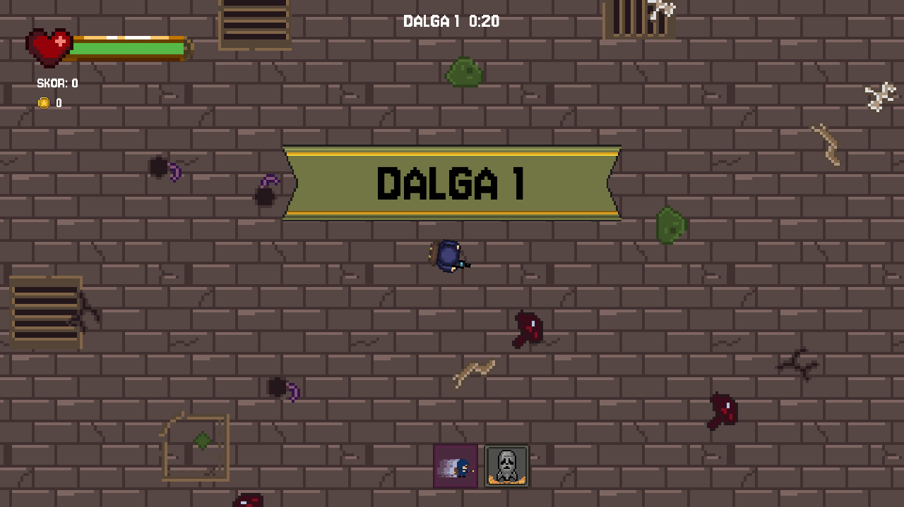
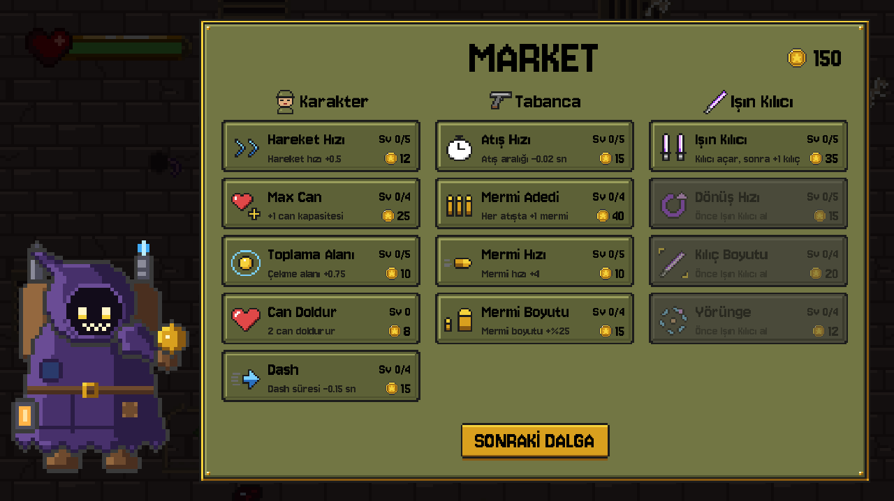

# Freak Survivor

Vampire Survivors / Brotato tarzı, dalga (wave) tabanlı bir 2D pixel art hayatta kalma oyunu. Unity'den **Godot 4.7**'ye taşındı.

Her dalgada süre dolana kadar canavar sürülerine karşı dayan, düşen altınları topla, dalga sonunda gezgin tüccarın marketinden karakterini, tabancanı ve ışın kılıcını geliştir. Dalgalar ilerledikçe düşmanlar hızlanır ve sıklaşır.





## Oynanış

1. **Ana menü:** zorluk seç (Kolay / Normal / Zor), dili seç (TR / EN), **OYNA**.
2. **Dalga:** "DALGA N" banner'ı geçer, sayaç başlar. Süre `min(20 + 5 × (N − 1), 60)` saniye.
3. Öldürdüğün her düşman **altın** düşürür (golem 10, diğerleri 1). Toplama alanına giren altın sana uçar; **mıknatıs** yerdeki tüm altınları çeker.
4. **Süre dolunca:** kalan düşmanlar silinir, toplamadığın altınlar kaybolur.
5. **Market:** altınla geliştirme al, **SONRAKİ DALGA** ile devam et.
6. Ölünce ulaştığın dalga Game Over ekranında görünür. Altın ve geliştirmeler o oyuna özeldir, kaydedilmez.

Her 5. dalganın ortasında bir **golem** (mini boss) çıkar.

### Kontroller

| Tuş | Eylem |
|---|---|
| WASD / Ok tuşları | Hareket |
| Fare | Nişan |
| Sol tık (basılı tut) | Ateş |
| Shift | Dash (kısa süre hasar almazsın) |
| Q | Atom bombası (ekrandaki tüm düşmanlar, 60 sn bekleme) |
| Esc | Duraklat (dalga sırasında) |

### Market

| Kategori | Geliştirmeler |
|---|---|
| **Karakter** | Hareket Hızı, Max Can, Toplama Alanı, Can Doldur (sınırsız), Dash bekleme süresi |
| **Tabanca** | Atış Hızı, Mermi Adedi, Mermi Hızı, Mermi Boyutu |
| **Işın Kılıcı** | Işın Kılıcı (ilk alım açar, sonra +1 kılıç), Dönüş Hızı, Kılıç Boyutu, Yörünge |

Fiyat her seviyede artar: `round(base_cost × cost_growth ^ seviye)`.

### Düşmanlar

Fare, Göz, Mumyavari, Zombi, Goblin ve mini boss **Golem**. Hız ve doğma sıklığı seçilen zorluğa ve dalga numarasına göre ölçeklenir.

## Çalıştırma

1. [Godot 4.7](https://godotengine.org/) kur.
2. Godot'da `project.godot` dosyasını aç ve **F5** ile çalıştır (ana sahne: `scenes/main_menu.tscn`).

**Windows build:** *Project → Export → Windows Desktop* ile `build/FreakSurvivor.exe` üretilir (`build/` git'e girmez).

### Test

Market fiyat/satın alma mantığı ve çeviri kontrolü:

```bash
godot --headless -s tests/test_upgrades.gd
```

Başarılıysa `test_upgrades: OK` yazar; başarısız bir assert'te çıkış kodu 1'dir.

## Proje yapısı

```
scenes/          main_menu, game, gold, bullet, isin_kilici, miknatis, enemies/
scripts/
  game_manager.gd      skor, altın, öldürme (kill_enemy), pause / game over
  wave_manager.gd      dalga döngüsü: INTRO → FIGHT → CLEANUP → SHOP
  enemy_spawner.gd     dalga numarasına göre spawn aralığı, golem
  shop_panel.gd        market arayüzü (kartlar koddan kurulur)
  upgrades.gd          market verisi ve satın alma mantığı
  settings.gd          zorluk, ses, dil (autoload: Settings)
  transition.gd        sahne geçişlerinde fade (autoload: Transition)
assets/
  sprites/ui/          market arayüz assetleri + Aseprite Lua üreteçleri
  sprites/merchant/    tüccar
  sprites/pickups/     altın
  sprites/map/         zemin ve dekorlar
  translations/        strings.csv (TR / EN)
tests/           test_upgrades.gd
```

### Yeni geliştirme eklemek

Kod değişmez, sadece veri: `scripts/upgrades.gd` içindeki `LIST`'e bir kayıt ekle. `target` sahnedeki düğüm yolu, `method` o düğümde çağrılacak fonksiyondur (`target.call(method, amount)`). Ad ve açıklamanın İngilizcesini `assets/translations/strings.csv`'ye eklemeyi unutma; test eksik çeviriyi yakalar.

### Çeviri

Bütün yazılar `assets/translations/strings.csv` dosyasında (`keys,tr,en`). Anahtar Türkçe metnin kendisidir. Kodda `tr("...")`, sahnedeki Label'larda ise anahtar metin otomatik çevrilir. Dil ana menüden değişir ve kaydedilir; ilk açılışta sistem dili Türkçe değilse İngilizce başlar.

### Pixel art assetleri

Arayüz assetleri (market paneli, kartlar, ikonlar, butonlar, banner, parlama, tüccar, altın) Aseprite Lua scriptleriyle üretilir. Her script `.aseprite`, sprite sheet `.png`, `.json` ve önizleme `.gif` çıkarır:

```bash
aseprite -b --script-param out=assets/sprites/ui --script assets/sprites/ui/upgrade_icons.lua
```

## Yapımcılar

**parkinson** ve **oridantes**
